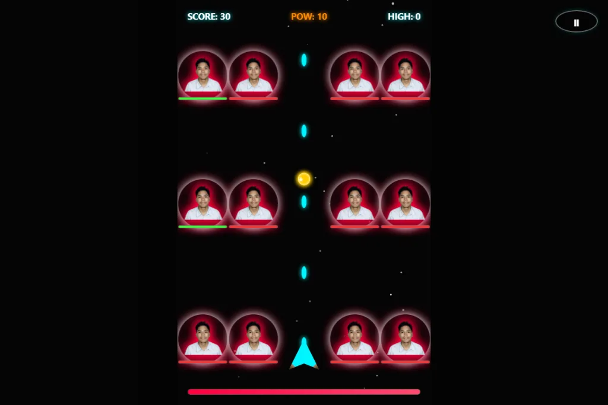

# ReihanWing 🚀👾

**Play it:** https://reihanhs.github.io/reihanwing/

A high-intensity, retro-cyberpunk arcade shooter inspired by EverWing, built with HTML5, CSS3, and Vanilla JavaScript.

## Features
- 🌠 **Dynamic Starfield**: Smooth, parallax background for deep space immersion.
- 🛸 **Unique Bosses**: Challenging boss fights with distinct attack patterns and personalities.
- 💎 **Reward System**: Collect Coins and high-value Emerald Gems to boost your score.
- 🔣 **Power-ups**: Triple Shot, Shields, Speed Rush, Damage Upgrades, and Magnet collection!
- 🖼️ **Custom Visuals**: Featuring personalized enemy graphics.
- 📱 **Mobile Ready**: Fully responsive layout with intuitive touch & drag controls.

## How to Play
- **Drag/Move**: Control your ship to dodge enemies and bullets while collecting loot.
- **Shooting**: Your ship fires automatically.
- **Goal**: Survive as long as possible, defeat bosses, and climb the high score leaderboard!
